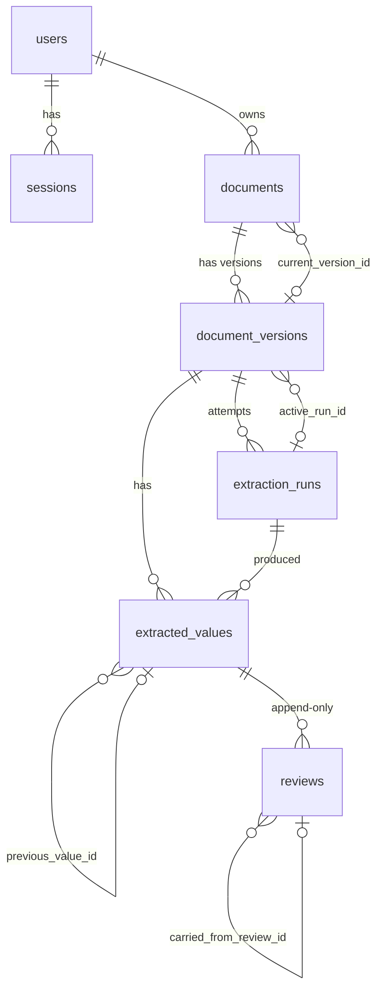

# Extraction and Review

Upload a PDF, have an LLM extract the document type's expected fields with the exact quote each value came from, then review each value (approve or correct). Upload a revised version and the reviews of values whose evidence did not change carry over; only the changed values come back for review.

**Live:** https://lomi.sairam.cc (bring your own OpenAI-compatible key; the login form asks for base URL, key and model).

This was built with AI coding tools. The session logs are submitted separately as a gist.

---

## 1. Run it

```sh
docker compose up --build
```

No `.env` is needed. Open http://localhost:3000. The port is bound to `127.0.0.1` only, because local mode has no login and must not be reachable from the network. There is no login in local mode, and the three sample documents are already seeded at version 1.

**LLM key**

- With a key: `cp .env.example .env`, set `LLM_BASE_URL`, `LLM_API_KEY`, `LLM_MODEL`, then `docker compose up --build`.
- Without a key: start the stack anyway. A banner links to an in-app settings form. Saving it verifies the provider, stores the key AES-GCM encrypted, and retries every failed run.
- Ollama running on the host: use the "Ollama" preset (`http://host.docker.internal:11434/v1`); compose maps that name to the host for the api and worker. `localhost` would point at the container itself.
- In the hosted (byok) mode, logging in again after a logout re-queues runs that failed only because no key was stored ("No LLM configured"); other failures stay failed until you retry them.
- The provider must support `response_format: json_schema` (checked on save and at login). Nothing else is sent (no `temperature`, no `max_tokens`).

**What to click first**

1. Open "Invoice - Meridian Office Supplies". Five values need review, each beside its source quote; the quote is highlighted in the text pane.
2. Approve them, correct one if you like.
3. "Upload new version" and pick `assignment/fixtures/documents/invoice-001.v2.pdf`.
4. When it finishes: exactly `due_date` and `total_amount` are pending, showing the previous value and review beside them. The other three show "Carried over" with their review intact.

The UI is dark-only (a deliberate call). The design system and screens were drawn on Claude's canvas first; links and the token table are in [`docs/design/README.md`](docs/design/README.md).

Optional S3-compatible storage for local dev: `docker compose --profile s3 up` with `S3_*` set (see section 8). The dev server is RustFS, because the MinIO image was not pullable.

---

## 2. Monorepo layout

Turborepo + pnpm, Node 24, TypeScript strict.

| Path | What it is |
|---|---|
| `apps/api` | NestJS HTTP API: auth, uploads, reviews, enqueue-after-commit |
| `apps/worker` | Separate Nest app context: BullMQ consumer, run lifecycle, reconciler, cleanup |
| `apps/web` | Next.js (App Router) + Tailwind 4 review UI; proxies `/api/*` to the API so cookies stay same-origin |
| `packages/db` | Drizzle schema, migration, `boot.ts` (migrate + seed), repositories shared by api and worker |
| `packages/extraction` | Pure logic: text folding, evidence validation, prompt, value normalisation, carry-over diff, LLM client, SSRF-safe fetch |
| `packages/shared` | zod contract and field types shared by web, api, worker |
| `packages/storage` | `FileStorage` interface, local-disk and S3 implementations, `createStorage(env)` |
| `packages/testing` | Fake OpenAI-compatible server used by e2e and chaos runs |
| `packages/config` | Shared tsconfig and eslint config |

Why the boundaries:

- **Extraction logic is pure.** Evidence validation and carry-over are the parts most likely to be wrong, so they live in `packages/extraction` with no DB, queue or network and are unit-tested directly.
- **Worker is its own process.** A slow or crashing extraction cannot take the API down, and `kill -9` of the worker is a case the design has to survive anyway.
- **One contract package.** web, api and worker validate against the same zod schemas.
- **Storage behind an interface.** Local disk and S3 are swappable; tests run one contract suite against both.

Turbo pipeline (`turbo.json`): `build`, `lint`, `typecheck`, `test`, `test:integration`, `dev`. `typecheck`, `test` and `test:integration` depend on `^build`; integration tests are never cached.

```sh
pnpm install
pnpm build | lint | typecheck | test | test:integration
```

CI (`.github/workflows/ci.yml`, on PRs and pushes to main):

- `ci` job: `pnpm turbo lint typecheck test build`, then `pnpm turbo test:integration`.
- `e2e` job: `docker compose up -d --build` with `compose.e2e.yml` (fake LLM), then the Playwright test.

---

## 3. Schema



(`packages/db/src/schema.ts` is the source of truth; one migration in `packages/db/drizzle`.)

How the pieces relate:

- **A document has many versions** (`unique(document_id, version_number)`). `documents.current_version_id` points at the latest; older versions and everything under them stay queryable.
- **A version has attempts, not one run.** `extraction_runs` rows are `unique(version_id, attempt)`; `document_versions.active_run_id` is the run whose result counts. A retry is a new row, so failed attempts keep their error, prompt and raw response.
- **A version has one value per field**: `unique(version_id, field_name)` on `extracted_values`. This is what makes double extraction harmless; the second insert hits `ON CONFLICT DO NOTHING`.
- **Extracted values are immutable.** The value, quote and gap reason are never updated.
- **Reviews are append-only** and sit beside the value. The latest row for a value is its current review. Effective value is the latest correction's `corrected_value`, else the extracted `value`.
- **Carry-over copies, never moves.** A carried review is a new `reviews` row with `origin = carried_over` and `carried_from_review_id` pointing at the original.
- **Changed values link back**: `previous_value_id` points at the same field's value in the baseline version, so the UI can show the previous value and its review.
- **Parsed text is stored per version** (`document_versions.parsed_text`), so evidence validation and highlighting for version N always use version N's text.
- Document status is the status of the current version's active run; a non-current version displays as `superseded`.
- Progress buckets (`pending`, `approved`, `corrected`, `carried_over`) are mutually exclusive and sum to the field count.

API surface: `POST /documents`, `POST /documents/:id/versions`, `GET /documents`, `GET /documents/:id`, `GET /documents/:id/progress`, `POST /documents/:id/retry`, `GET /documents/:id/versions/:n/file`, `POST /values/:id/review`, `PUT /settings/llm`, `/auth/*`, `/health`.

---

## 4. How extraction is coordinated

**Postgres is the system of record and the outbox. Redis only carries run ids.**

| | Postgres | Redis (BullMQ) |
|---|---|---|
| Holds | documents, versions, parsed text, runs (status, lease, error, prompt, raw response), values, reviews | one job per run: `jobId = runId`, `attempts: 1` |
| Lost if wiped | everything that matters | nothing; the reconciler rebuilds it from `queued` runs |
| Persistence | yes | off (`--save "" --appendonly no`), on purpose |

Flow:

1. **API, one transaction:** insert version + run (`queued`) + set `active_run_id` (+ `current_version_id`). Commit. Only then `queue.add('extract', {runId}, {jobId: runId})`. An enqueue failure is logged, not surfaced; the reconciler covers it. Upload never waits for the LLM.
2. **Worker claims atomically:** `UPDATE extraction_runs SET status='extracting', lease_expires_at=now()+60s WHERE id=$1 AND status='queued'`. Zero rows means duplicate delivery: drop it. A heartbeat extends the lease every 15s.
3. **Before the LLM call:** if the version is no longer the document's current one, mark the run `superseded` and stop.
4. **Parse, call the LLM, validate evidence, compute carry-over.** Then one finalize transaction: lock the document row, **re-read** the run and version, and proceed only if the run is still `extracting` and still the version's `active_run_id`. Otherwise roll back and write nothing. Values are inserted `ON CONFLICT (version_id, field_name) DO NOTHING`, together with carried reviews and `status='extracted'`.
5. **Failures are states.** `transient` (network, 5xx, 429, timeout): run `failed`, new attempt queued, up to 3 attempts, each a new run row. `permanent` (PDF parse, schema-invalid output, 4xx/auth, source file missing, no LLM configured): run `failed`, document visibly failed, `POST /documents/:id/retry` queues a new run.
6. **Reconciler (worker boot, then every 30s):** re-add every `queued` run to BullMQ (removing a finished BullMQ job with the same id first, since an existing id would silently no-op the add), and mark every `extracting` run with an expired lease `failed`/`transient` ("worker lost lease") and apply the retry rule.
7. Every run stores its prompt and raw response.

Failure matrix:

| Failure | What happens |
|---|---|
| Redis `FLUSHALL` (and restart) | No Postgres row changes. On the next reconcile tick, queued runs are re-added and runs whose lease expired are failed and retried. Nothing stuck. |
| Worker `kill -9` mid-run | Lease stops being extended; within about 60s plus a tick the reconciler fails it as transient and queues attempt+1. Document completes or ends visibly failed. |
| API crashes between commit and enqueue | Run is `queued` in Postgres with no job. Reconciler enqueues it. Upload response may be lost; nothing else is. |
| LLM transient error (429, 5xx, timeout) | Run `failed`/`transient`; new attempt queued up to 3 total. After that the document stays `failed` and retryable. |
| LLM permanent error (auth, schema-invalid output) | Run `failed`/`permanent` with the message; document shows failed; user retries after fixing key/settings. |
| PDF cannot be parsed | Permanent failure, visible, retryable. |
| Duplicate delivery or double retry | Atomic claim lets one worker proceed. Finalize guard plus `unique(version_id, field_name)` make a second write a no-op or a rollback. No duplicated values. |
| Postgres down | API returns errors; worker cannot claim or finalize; nothing is acknowledged as done. State is unchanged when it returns; heartbeats resume or leases expire and the reconciler recovers. Redis is not a substitute for it. |
| Version uploaded mid-extraction | New version becomes current immediately (supersede). Old run marks itself `superseded` before the LLM call, or, if already past it, completes but its values are never current. |

The chaos script (section 7) exercises the worker-kill and `FLUSHALL` rows against a real stack.

Other worker jobs: byok users idle more than 7 days are deleted (cascade); an hourly sweep removes orphan files (section 8).

---

## 5. Evidence, hallucination defense, carry-over

**Extraction.** The LLM returns per field `{ value | null, evidence | null, gap_reason | null }` under a strict `json_schema` built from `assignment/fixtures/expected-fields.json`. Values are normalised by type (`string` trimmed, `date` -> `YYYY-MM-DD`, `money` -> `{amount, currency}`, `percent`/`number` -> number). Unparseable -> gap "value not parseable as <type>".

**Evidence validation (`packages/extraction/src/evidence.ts`).** The quote must be a **case-sensitive substring of that version's stored `parsed_text`** after folding both sides: NFKC, curly quotes and dashes folded to ASCII, whitespace runs collapsed to one space (PDF line breaks). If it is not found, or the quote is empty, the value is **discarded and stored as a gap** with reason "evidence not found verbatim in document text". A field the LLM could not find is a gap with the LLM's reason. Offsets are mapped back to the raw text for highlighting. Nothing is ever kept without a verified quote.

**"Unchanged" (`packages/extraction/src/carryover.ts`).** Per field name, against the most recent other version that has an `extracted` run:

- unchanged iff the **canonical value** is equal **and** the evidence agrees: either the **normalised evidence** (NFKC, quote/dash folding, whitespace collapse, casefold) is equal, or the **cross-text check** passes: the baseline's quote is found verbatim in the NEW version's parsed text, or the new quote is found verbatim in the BASELINE version's parsed text. This keeps a merely reworded quote ("Invoice Number: INV-2025-0847" vs "INV-2025-0847") from dropping a review. A different value is always `changed`, whatever the quotes say. For gaps: both null and the same gap reason.
- Matching is by field name, not position, so text moving around the page or shifting between pages does not matter; only the quoted passage and the value do.
- Unchanged and the baseline value has a review -> insert a copy with `origin = carried_over`. Unchanged without a review -> pending, `change_status = unchanged`.
- Otherwise `changed` (or `new` if there is no baseline) -> pending, with `previous_value_id` set.

Known limit: a reworded quote whose old text is no longer in the new document, and which is not in the old one either, counts as changed. That is the safe direction (a reviewer looks again), not a silent carry. The UI names the baseline by its real version number, which is not always the previous one (after a superseded upload it can be older).

---

## 6. Decisions the brief left open

| Decision | Choice | Why |
|---|---|---|
| Version arrives while previous is extracting | **Supersede**: new version is current at once; old run marks itself superseded before the LLM call, or finishes but is never current | Reject frustrates the user; queueing wastes an LLM call on text nobody will review. Old data stays queryable. |
| Correction model | **Annotation beside the value**; `extracted_values` immutable, `reviews` append-only, latest wins | History and the original LLM output are never lost; carry-over copies a review instead of mutating a value. |
| Review of gaps | A gap can be approved (confirmed missing) or corrected (reviewer supplies value) | Gaps must be visible and resolvable, never hidden. |
| UI refresh | **Poll every 2s, only while a shown document is `queued`/`extracting`** (TanStack Query) | Updates are infrequent and per-user; polling is stateless, needs no sticky connection, and works through the proxy. SSE is the next step at scale. |
| What "unchanged" means | Normalised evidence AND canonical value equal, by field name | Robust to layout shifts; see section 5. |
| Parsed text | Stored once per version | Version N's evidence check and highlighting never depend on re-parsing or on N+1. |
| Structured output | `json_schema` only, checked at login; no fallbacks, no `temperature`/`max_tokens` | One strict path to test; weaker JSON modes would need extra repair logic. Providers that reject it are rejected up front. |
| Auth on live | BYOK: user = `HMAC-SHA256(SESSION_SECRET, normalised base URL + "\n" + key)`; same key and endpoint -> same workspace. Key encrypted AES-256-GCM, never returned to the browser, deleted on logout. Cookie `sid` httpOnly, Secure, SameSite=Lax, 7-day sliding | Nobody pays for an LLM on the public deploy, and no accounts to manage. SSRF guard on base URLs: https only, private/loopback/link-local/metadata IPs rejected, no redirects, rechecked at connect time. |
| Auth locally | `AUTH_MODE=local`: no login, no cookies, no session rows; one built-in local user. api and worker **refuse to start** if `AUTH_MODE=local` and `PUBLIC_ORIGIN` is not localhost/127.0.0.1; in byok they refuse the dev-default secrets | `docker compose up` must work with nothing configured; the guards stop that convenience from being deployed. |
| Workspaces | Private per user; the 3 sample documents are seeded at v1 on first login (idempotent via `unique(user_id, external_id)`) | Reviewers on the live site can click around immediately without touching each other's data. |
| File storage | Local volume by default, S3 automatically when bucket + access key + secret are all set; key `pdfs/<slug>-<sha256>.pdf`; storage write before DB commit; owner-only access; signed URLs | See section 8. |
| Theme | Dark-only | Product decision; one set of tokens to get right. |
| Limits | PDF only (`%PDF-` check), <= 5 MB, <= 25 documents per user, <= 5 in-flight runs per user, login 10/min/IP | Keeps one key from running up cost or filling disk. |

---

## 7. Tests

| Layer | What | Run |
|---|---|---|
| Unit (Vitest) | Evidence validation, folding, carry-over, value assembly, prompt, LLM client, SSRF-safe fetch, PDF parsing, storage keys, crypto, config guards, web helpers | `pnpm test` |
| Integration (Vitest + Testcontainers: real Postgres and Redis; needs Docker) | Upload/review/version/retry through the API; auth in byok and local modes; worker claim, heartbeat, supersede, finalize guard, transient retry; reconciler (re-enqueue, expired leases); seed idempotence; progress buckets; storage contract against local and S3 | `pnpm test:integration` |
| E2E (Playwright, against the compose stack with a fake LLM, no network or key) | Review all 5 invoice values, upload v2, expect 2 pending, 3 carried over, previous values shown | see below |
| Chaos (`bash scripts/chaos.sh`, against a live stack) | Worker killed mid-extraction; Redis `FLUSHALL` + full restart | see below |

E2E:

```sh
export COMPOSE_PATH_SEPARATOR=: COMPOSE_FILE=compose.yml:compose.e2e.yml
docker compose up -d --build
pnpm --filter @lomi/web exec playwright install chromium
pnpm --filter @lomi/web test:e2e
docker compose down -v
```

Chaos (stack already up):

```sh
# leg (b): wipe Redis, restart everything; asserts nothing stuck and Postgres row counts unchanged
docker compose up -d
bash scripts/chaos.sh redis

# leg (a): needs a SLOW LLM so a run stays `extracting` long enough to kill the worker
export COMPOSE_PATH_SEPARATOR=: COMPOSE_FILE=compose.yml:compose.e2e.yml
FAKE_LLM_DELAY_MS=20000 docker compose up -d --build
bash scripts/chaos.sh worker

bash scripts/chaos.sh          # both legs
```

The `COMPOSE_FILE` export keeps the worker restart on the e2e config (otherwise it comes back with no LLM). On Windows, the default `COMPOSE_FILE` separator is `;`, so the explicit `COMPOSE_PATH_SEPARATOR=:` in the export matters: run the script from Git Bash with both variables exported as shown. Tunables are listed at the top of the script.

### What was verified

All locally on 2026-11-27, with the fake LLM:

- The e2e Playwright flow passed against the e2e compose stack.
- Chaos leg (a): the worker killed mid-extraction recovered, and the run reached `extracted`.
- Chaos leg (b): `FLUSHALL` plus a full restart kept the data identical (3 documents / 6 versions / 31 values / 14 reviews).

Not yet run against a real LLM or the live site.

---

## 8. File storage

- `FileStorage { put, get, exists, delete, list(prefix), signedGetUrl }` in `packages/storage`.
- **Selection:** S3 when `S3_BUCKET`, `S3_ACCESS_KEY_ID` and `S3_SECRET_ACCESS_KEY` are all set (plus `S3_ENDPOINT`, `S3_REGION`, `S3_FORCE_PATH_STYLE` as needed); otherwise local disk at `STORAGE_DIR` (`/data/files`, a named compose volume shared by api, worker and migrate). A partial S3 config fails startup naming the missing variables.
- **Key:** `pdfs/<slug>-<sha256>.pdf`; the slug is the original filename lower-cased, non-alphanumeric runs to `-`, max 80 chars. Same name and bytes -> same key, so re-uploads overwrite idempotently.
- **Order:** storage put, then DB commit. A version row always points at an existing file; the reverse failure leaves only an orphan file. A missing file at extraction time is a permanent failure ("source file missing").
- **Orphan sweep:** hourly in the worker, deletes keys under `pdfs/` older than 1h that no `document_versions.storage_key` references. User deletion removes rows only; the sweep removes their files.
- **Access:** `GET /documents/:id/versions/:n/file` requires the owner. Local storage streams the PDF; S3 answers `302` to a presigned URL valid for 300s.
- **Caveat:** under `--profile s3` the signed URL points at the in-network host (`rustfs:9000`), so "Open PDF" from the host browser does not resolve. Uploads, extraction and everything else work.

---

## 9. Deploy

Single VPS at `lomi.sairam.cc`. GitHub Actions -> GHCR -> SSH.

- `deploy.yml` runs after CI succeeds on a push to main (or by manual dispatch): builds `lomi-api`, `lomi-worker`, `lomi-web` and pushes them to `ghcr.io` tagged with the commit SHA and `latest`; copies `compose.yml`, `compose.prod.yml`, `Caddyfile` and a generated `.env` to `~/lomi` on the VPS; pulls the images one at a time with retries (parallel pulls from GHCR's CDN get reset on this VPS), `up -d`; then checks `https://lomi.sairam.cc/api/health`.
- Prod overlay: `AUTH_MODE=byok`, no secret defaults (compose fails if any is unset), **no published ports**, `TRUST_PROXY_HOPS=2` (Caddy -> Next -> api). The VPS already runs one shared Caddy on 80/443 for all its projects, so lomi doesn't bring its own: `web` joins that proxy's Docker network (`EDGE_NETWORK`, default `booksland-sales-tracker_bookstore_net`) as `lomi-web`, and the block in `./Caddyfile` is added once to the shared proxy's Caddyfile (one-time server step; TLS is automatic). The api is never published: its login throttle trusts `X-Forwarded-For`, which is only safe when every hop is ours.
- **Setup:** `bash scripts/setup-deploy.sh` is an interactive wizard for the deploy key, the DNS A record and `gh secret set`.
- **Required secrets:** `VPS_HOST`, `VPS_USER`, `VPS_SSH_KEY`, `SESSION_SECRET`, `KEY_ENCRYPTION_KEY` (64 hex chars), `POSTGRES_PASSWORD`. Optional (written to `.env` only when set): `S3_ENDPOINT`, `S3_REGION`, `S3_BUCKET`, `S3_ACCESS_KEY_ID`, `S3_SECRET_ACCESS_KEY`, `S3_FORCE_PATH_STYLE`. The VPS address is never committed.
- **Post-deploy throttle check (manual):** send more than 10 `POST /api/auth/login` requests within a minute, each with a different spoofed `X-Forwarded-For` header. You should still get `429`, because with two trusted hops the client IP is taken from what Caddy appended, not from the spoofed value.

---

## 10. What I cut, and what I would do next

- **No review editing or undo.** Reviews are append-only; a mistaken approve is fixed by submitting another review, and the UI has no history view of reviews.
- **Limits are not transactional.** The 25-document and 5-in-flight checks are count-then-insert, so concurrent requests can overshoot slightly. (The 20-versions-per-document cap is enforced under the document lock, so it does not overshoot; it answers `409 VERSION_LIMIT`.)
- **A value is not cross-checked against its quote.** Only the quote's presence in the document text is verified, not that the quote actually supports the extracted value.
- **No SSE/WebSocket.** 2s polling while busy.
- **S3 dev signed-URL host** (section 8).
- **Single region, single VPS, single worker process.** No horizontal scale story beyond adding workers (the claim is atomic, so that is safe).
- **No observability.** Structured logs only; no metrics, tracing or alerting.
- **OpenAI-compatible APIs only, and only with `json_schema`.** No native Anthropic or Gemini adapters, no JSON-mode fallback.
- **Fixed document types** (`invoice`, `lease`, `market_report`) driven by `expected-fields.json`; no schema editor.
- **Whole-document prompt**, one LLM call per version; no chunking for long documents.
- No scanned-PDF/OCR support; text must be extractable.

---

## 11. At 10,000 documents

- **S3 by default and presigned direct-to-bucket uploads**, so the API stops proxying bytes; register the version when the object lands.
- **Postgres:** partition `extracted_values` and `reviews` by document (or user); add indexes for the list and progress queries; archive old versions' parsed text and raw responses to cold storage.
- **Push instead of poll:** `LISTEN/NOTIFY` from finalize feeding SSE, rather than every client polling every 2s.
- **Queue fairness and limits:** per-tenant queues or rate limiting so one user's backlog cannot starve others; per-tenant LLM concurrency; transactional quota checks.
- **Batch LLM APIs** for bulk and re-extraction jobs at lower cost, with the synchronous path kept for interactive uploads.
- **Text-diff-anchored carry-over:** align old and new text, then carry a review when the cited span maps across, instead of comparing quote strings. This handles reworded-but-equivalent evidence.
- **Background parsing workers** separate from extraction workers (and OCR for scans), so parsing cost is scaled and retried independently.
- **Reconciler at scale:** it scans by status every 30s today; it would need an index on `(status, lease_expires_at)` and batching, or leader election across several workers.
- **Observability:** run durations, retry rates, queue depth, lease expiries, LLM cost per document.
